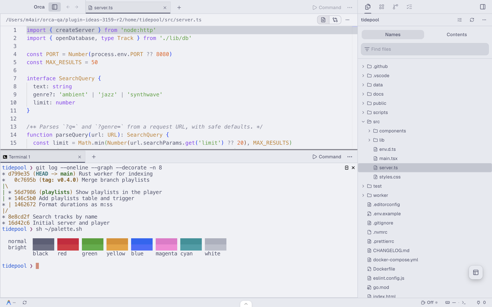

# Catppuccin for Orca

Soothing pastel themes for Orca, from [Catppuccin](https://github.com/catppuccin/catppuccin): **Mocha** for dark mode and **Latte** for light mode. Each is an app theme covering the interface and code colors. For the terminal, use the Catppuccin terminal themes built into Orca.

## Use it

After installing it from **Settings → Plugins**:

1. In **Settings → Appearance**, choose **Catppuccin Mocha** as the dark theme and **Catppuccin Latte** as the light theme.
2. In **Settings → Terminal**, choose Orca's built-in **Catppuccin Mocha** and **Catppuccin Latte** terminal themes.

## What's included

| Theme | Kind | Based on |
| --- | --- | --- |
| Catppuccin Mocha | App theme (dark) | Catppuccin Mocha |
| Catppuccin Latte | App theme (light) | Catppuccin Latte |

Interface colors follow Catppuccin's style guide: base for the editor, mantle for sidebars, crust for the deepest panels, and mauve for the accent. Code uses Catppuccin's syntax colors: mauve keywords, green strings, peach numbers, yellow types and overlay comments in italics.

## Differences from Catppuccin

- **Latte code colors are slightly darker.** Orca drops code colors that don't reach 3:1 contrast with the editor background, and a few of Latte's colors (sky, green, yellow, peach, pink, rosewater) fall just short on its light base. Their code colors are darkened only as far as needed, keeping the hue. Mocha needs no changes.
- **Function names use the text color in TypeScript and JavaScript.** Orca's editor marks function names the same as other identifiers in those languages, so no theme can color them separately yet.

## Rebuilding

The app theme files are generated from Catppuccin's `palette.json` by [`catppuccin-build.py`](https://github.com/brennanb2025/orca-plugins/blob/main/tools/catppuccin-build.py), which also runs the contrast checks.

## License

An unofficial Orca port of [Catppuccin](https://github.com/catppuccin/catppuccin). MIT. Colors © Catppuccin. See [LICENSE](LICENSE).
