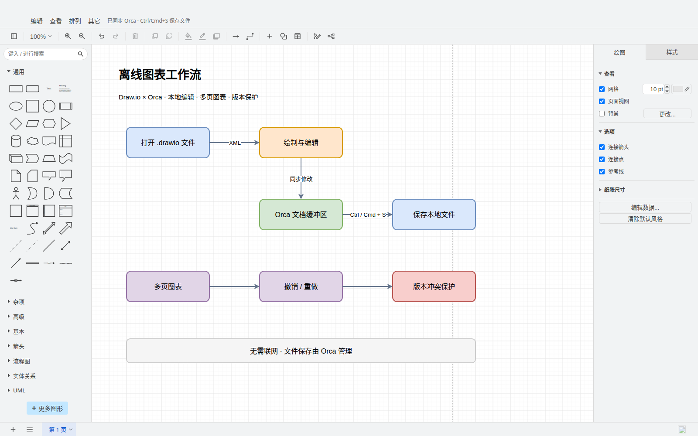
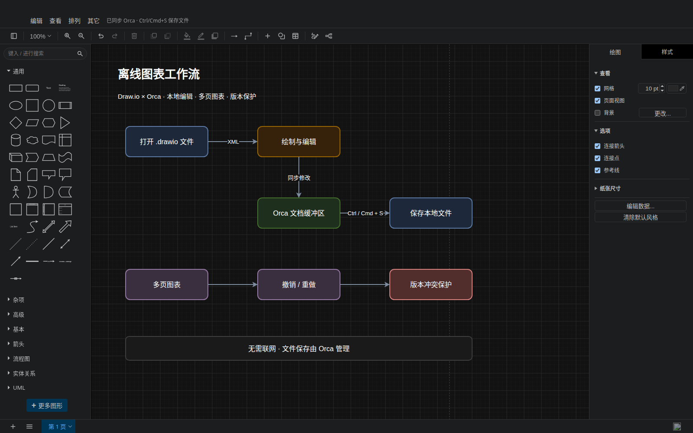

# Draw.io for Orca

在 Orca 编辑器内离线编辑 `.drawio`、`.drawio.xml` 文件。采用 draw.io 的真实编辑器，不需要打开在线 diagrams.net，也不会把图表发送到远程服务。集成方式参考官方 Excalidraw 插件的 `sandboxed-ui` / `customEditors` 文档接口，未复制官方插件源码。






## 使用

在 Orca 的插件管理中添加本目录作为本地开发插件（需要通过 manifest 校验）。通过新建文件菜单选择「新建 Draw.io 图表」，或打开已有 `.drawio` 文件。编辑器页用于绘图，Source 页可以检查和修改 XML。

- 中文菜单、形状拖放、连线、文本、样式和图层。
- 常用矢量图形库：通用、UML、ER、BPMN、流程图、基础形状和箭头。
- 多页图表，支持压缩和未压缩的 draw.io XML，保留自定义 mxfile 属性。
- 撤销与重做、缩放、网格、背景颜色和页面设置。
- 跟随 Orca 深浅主题；只读文档禁止写回。
- 约 200 ms 后将变化同步到 Orca 文本缓冲区；文件的脏状态、磁盘保存以及 Ctrl/Cmd+S 由 Orca 管理。保存前等待 `editor.flush`，版本冲突由 Orca 拒绝；失败会显示状态提示，不冒充保存成功。
- 无效文件显示错误并保留源文，不会用空图覆盖。

## 当前范围

这是离线 XML 编辑器。云端存储、在线搜索、AI、远程图片/字体、第三方插件、MathJax、Mermaid/Visio 导入以及依赖额外脚本的布局不在本版本范围内。初始界面提供上述矢量库；上游「更多图形」中的远程图片库不保证可用。需要图片时请使用包含 data URI 的图表。PNG/SVG 中嵌入图表的二进制文件不注册为编辑器类型，普通 `.xml` 文件也不会被接管。

导出与浏览器文件菜单未接入；使用 Orca 保存 `.drawio`，需要其他导出格式时可用 draw.io 桌面版打开。编辑器菜单中保留的上游功能可能受 Orca 沙箱限制。

## 构建与验证

运行需要 Node.js 22+，编辑器运行需要支持 `DecompressionStream` 的 Orca Chromium。构建完全使用 Node 内置模块，产物已包含在 `editor/index.html`，安装后无需 npm 或联网。

```sh
git clone --filter=blob:none --no-checkout https://github.com/jgraph/drawio.git /tmp/orca-drawio-upstream
git -C /tmp/orca-drawio-upstream checkout 84487b4891cbc0f32d7e30f34cf878c87cb1f414
DRAWIO_DIR=/tmp/orca-drawio-upstream node plugins/drawio/build/build.mjs
ORCA_DIR=/data/LinDoo/orca node plugins/drawio/build/tests/editor.test.mjs
node /data/LinDoo/orca/config/scripts/validate-plugin-files.mjs plugins/drawio
```

构建脚本核对上游固定提交；将编辑器、形状、stencil、中文资源、样式和静态 UI 图片嵌入一个 gzip/base64 载荷，运行时解压并作为内联脚本执行，遵守 Orca 禁网且禁止 `eval` 的 CSP。入口大小不得超过 10 MiB。源码在 `build/src/`，请修改源码后重新构建，勿直接修改生成的 HTML。

浏览器测试使用 `ORCA_DIR` 中已安装的 Playwright，需要已安装 Chromium（`playwright install chromium`）。测试运行在 `sandbox="allow-scripts"` 的不透明 origin 下，并使用 Orca 相同的 CSP，覆盖干净打开、形状编辑、保存刷新、撤销重做、背景配置、压缩多页、自定义属性、冲突重试、只读、无效 XML 和主题，断言没有网络请求。测试用文档宿主替身模拟 Orca 接口；真实 Orca 中的安装与快捷键还需手动验收。

## 发布状态

本插件以 `lindoo.drawio` 提交至上游仓库审核，展示作者为 LinDoo。目录条目位于仓库根目录的 `orca-catalog.json`，发布记录通过 `scripts/release-entry.mjs` 从已提交的插件内容生成。

## 许可证与来源

本插件使用 Apache-2.0。内嵌 draw.io 32.6.1，固定提交 `84487b4891cbc0f32d7e30f34cf878c87cb1f414`，来自 <https://github.com/jgraph/drawio>，其版权和许可证见 `THIRD_PARTY_NOTICES.txt` 和 `LICENSE`。编译脚本保留上游 JavaScript 内的许可证注释。未将 draw.io 商标或图标作为本插件的自有标识。

## 图片资源

`images/icon.png` 为市场图标（256×256），`images/tab-icon.png` 用于编辑器标签和新建菜单（128×128），`images/cover.webp` 为市场封面（1600×1000）。三张 `editing-*.png` 是实际离线编辑器截图（1600×1000），已在 manifest 中注册。旧预览 `editor-dark.png` 保留。

图标和封面使用内置 imagegen 生成，提示词与来源见 [图片资源说明](images/README.md)。封面为宣传插画；界面截图由 Playwright 实际运行编辑器生成。可用 `ORCA_DIR=/data/LinDoo/orca node plugins/drawio/build/preview.mjs` 重新生成截图，设置 `DRAWIO_ICON_SOURCE`、`DRAWIO_COVER_SOURCE` 为原始 PNG 文件路径可重新导出图标与封面。
