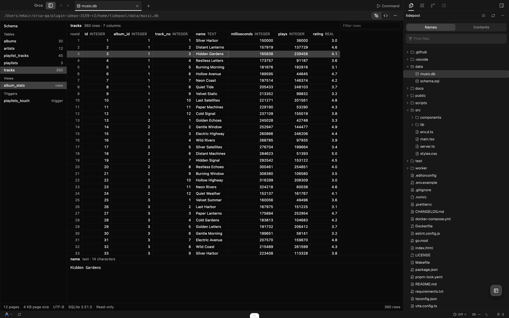
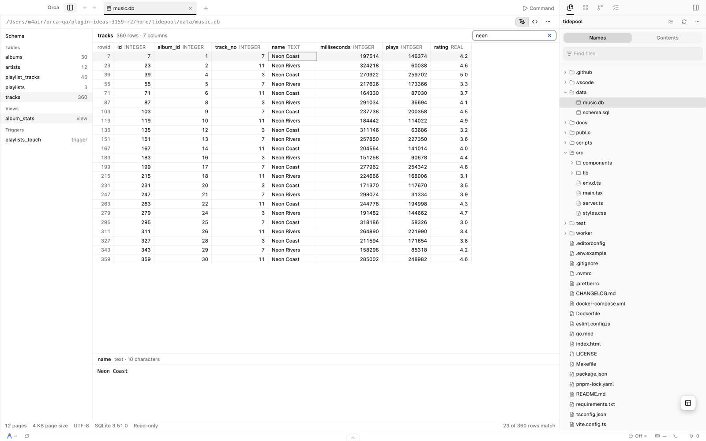

# SQLite Browser for Orca

Open SQLite databases in an Orca editor tab. Browse every table, view, index and trigger, and scroll or filter through millions of rows without leaving Orca. It only reads: nothing in the database changes.

## Use it

After installing it from **Settings → Plugins**, open any `.db`, `.sqlite`, `.sqlite3` or `.db3` file from the file explorer. To see the raw file instead, switch the tab to **Source**.

- **Tables:** pick one on the left to see its rows. The grid only draws the rows on screen, so tables with millions of rows scroll smoothly.
- **Filter rows:** type in the box at the top right to keep rows where any column contains the text.
- **Cell values:** select a cell to see its full value below the grid. Long text wraps and binary values show as hex.
- **Schema:** see the `CREATE` statement of any table, view, index or trigger. Views show their query, since a view stores no rows of its own.
- **Copy:** copy the selected cell with ⌘C or Ctrl+C.

The browser follows your Orca theme and reloads when the file changes on disk.

## Good to know

- **Read-only.** To change data, use the `sqlite3` command line or your app.
- **Files up to 64 MB.** That is the most Orca hands to a plugin editor. A large file can take a few seconds to show its first rows.
- **Recent writes may be missing.** In a database that uses write-ahead logging, the newest changes can sit in a separate `-wal` file that this browser doesn't read; it shows a notice when that may be the case. Reopen the file after the app closes the database.
- **No network.** The browser runs in Orca's sandbox for plugin editors, with no network access, and reads the file with its own SQLite reader. Encrypted databases can't be opened.

## License

MIT. See [LICENSE](LICENSE).
